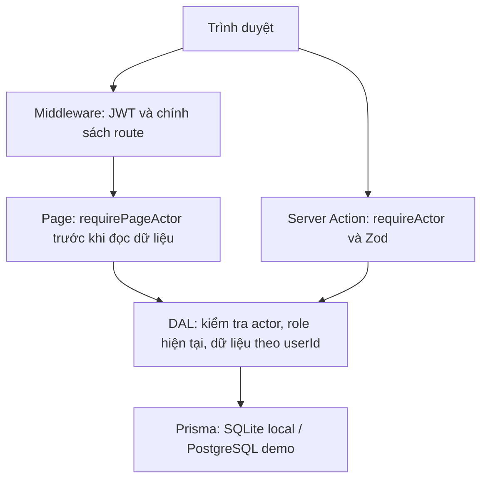

# Báo cáo Ex-07 — Bài tập tuần 8: Next.js

Nguyễn Tiến Tuấn — **B23DCCC173** · RIPT1411-20261-02 · Giảng viên: Ngô Văn Nhận. Kiểm chứng local: 09/11/2026.

## 1. Kết quả theo đề và slide

| Yêu cầu                    | Cài đặt / minh chứng                                                                                                                                                                                   |
| -------------------------- | ------------------------------------------------------------------------------------------------------------------------------------------------------------------------------------------------------ |
| NextAuth + email/mật khẩu  | Auth.js v5, Credentials, bcrypt 12 rounds, JWT httpOnly; đăng nhập/đăng xuất admin và user đã qua E2E                                                                                                  |
| Ít nhất một OAuth provider | GitHub OAuth đã kiểm chứng thật trên demo: callback thành công, phiên có id/role user, dashboard truy cập được, admin bị chặn và logout hoạt động. [Minh chứng](docs/evidence/demo/oauth-results.json) |
| Phân quyền nhiều lớp       | Middleware → page; mỗi action/route handler tự xác thực; DAL lọc theo userId từ phiên. Đọc lại role trong DB để chặn JWT admin đã bị thu quyền                                                         |
| TypeScript và validation   | Session/User/JWT augmentation; role `admin` / `user`; không dùng `any` trong source/test; Zod kiểm tra input, không tin role/userId gửi từ client                                                      |
| SEO ≥ 2 trang công khai    | `/products` và `/products/[slug]`: canonical, Open Graph 1200×630, JSON-LD. Product + Offer + BreadcrumbList; CollectionPage + ItemList; metadataBase, sitemap, robots; trang riêng noindex            |
| Báo cáo / hiệu năng        | Bảng trước/sau bên dưới, commit đối chiếu, báo cáo Lighthouse JSON/HTML gốc và 15 ảnh giao diện local + 4 ảnh Lighthouse + 8 ảnh demo public                                                           |

Đối chiếu cụ thể slide Buổi 7–8 nằm tại [đề bài](../../docs/de-bai/Tuan-08-NextJS.md). Hai file PowerPoint được giữ nguyên trong `docs/slides/`. Số thứ tự trong repo là Ex-07; tên bài học vẫn là tuần 8.

## 2. Các lớp bảo vệ

| Vai trò | `/dashboard`    | `/admin/products` | Sửa/xóa sản phẩm                    | Lưu sản phẩm           |
| ------- | --------------- | ----------------- | ----------------------------------- | ---------------------- |
| Khách   | Chuyển `/login` | Chuyển `/login`   | Từ chối                             | Yêu cầu đăng nhập      |
| user    | Cho phép        | Chuyển `/403`     | Từ chối cả khi gọi action trực tiếp | Chỉ danh sách của mình |
| admin   | Cho phép        | Cho phép          | Cho phép sau validation             | Chỉ danh sách của mình |

Page kiểm tra riêng, không dựa vào layout hay ẩn nút. Middleware dùng Node.js runtime được Next 15.5 hỗ trợ; `auth.config.ts` vẫn tách khỏi Prisma/bcrypt. OAuth xác định danh tính bằng GitHub providerAccountId, không tự liên kết với admin theo email. Sửa giá/tồn kho có kiểm tra updatedAt để chặn ghi đè dữ liệu cũ. Mật khẩu giới hạn 72 byte để tránh bcrypt cắt ngầm; thử đăng nhập được giới hạn theo tài khoản trong SQLite.

## 3. Lighthouse trước và sau

Đo production bằng `next build` + `next start`, localhost:3000; Lighthouse 13.6.0, Chrome 156, mobile 412×823 / DPR 1.75, simulated throttling (150 ms RTT, 1.638 Mbps, CPU ×4). Mỗi URL **3 lần** mỗi mốc; chọn lần có Performance trung vị và lấy các chỉ số cùng lần đó. Cùng nội dung, thiết bị, URL và cấu hình đo. Không chạy build/test song song với benchmark. Thông tin môi trường và từng lần đo nằm trong summary/raw JSON.

| Trang                   | Performance  | LCP           | TBT          | CLS           | Tổng dung lượng truyền |
| ----------------------- | ------------ | ------------- | ------------ | ------------- | ---------------------- |
| `/products`             | 91 → **98**  | 3.35 → 2.07 s | 105 → 144 ms | 0.000 → 0.000 | 562.4 → 183.9 KiB      |
| `/products/keychron-q1` | 96 → **100** | 2.63 → 1.80 s | 76 → 44 ms   | 0.000 → 0.000 | 449.7 → 165.5 KiB      |

| Trang                   | Accessibility | Best Practices | SEO           |
| ----------------------- | ------------- | -------------- | ------------- |
| `/products`             | 94 → **100**  | 100 → **100**  | 100 → **100** |
| `/products/keychron-q1` | 96 → **100**  | 96 → **100**   | 100 → **100** |

Baseline: `8dd4bee`; bản tối ưu: `7b5eae0`. Thay đổi chính: WebP + next/image với sizes/priority/lazy loading, bỏ request font không cần thiết; tách Ant Design về form đăng nhập và quản trị; controls native ở catalogue và nút lưu. First Load JS catalogue **233 → 113 kB**, chi tiết **210 → 115 kB** theo next build. Sửa contrast, thứ tự heading và tránh request 401 khi khách chưa có phiên.

- [Trước: summary](docs/evidence/lighthouse/baseline/summary.json) · [catalogue HTML](docs/evidence/lighthouse/baseline/catalogue-median.html) · [chi tiết HTML](docs/evidence/lighthouse/baseline/product-median.html).
- [Sau: summary](docs/evidence/lighthouse/optimized/summary.json) · [catalogue HTML](docs/evidence/lighthouse/optimized/catalogue-median.html) · [chi tiết HTML](docs/evidence/lighthouse/optimized/product-median.html).
- [Vòng đo trung gian](docs/evidence/lighthouse/iteration-1/summary.json) được giữ lại: ảnh nhẹ hơn nhưng TBT còn cao, là căn cứ thu hẹp JavaScript công khai.

Điểm có thể dao động theo máy và tải hệ thống. Đây là số đo lab Lighthouse, **không phải PageSpeed Insights công khai, không có field INP**. TBT không được gọi là INP. Đã kiểm tra thêm canonical/JSON-LD/OG trên domain demo HTTPS. Google Rich Results Test trong phiên kiểm tra trả thông báo “Something went wrong / Log in and try again”, nên chưa ghi nhận kết quả từ công cụ Google; không cam kết Google hiển thị rich result. [Trạng thái kiểm tra](docs/evidence/demo/google-rich-results.json).

## 4. Kiểm thử và ảnh minh chứng

- Typecheck (có next typegen), ESLint, format và production build: đạt.
- Jest + RTL: **10 suites, 70 test pass**. Coverage phạm vi cấu hình trong jest.config.mjs: statements **94.66%**, branches **89.02%**, lines **96.7%**; không mô tả thành coverage toàn dự án.
- Playwright: **9 luồng pass**, không skip/flaky. Kiểm tra login sai/đúng, cookie/role, user bị chặn admin, sửa/xóa và persistence, cache invalidation, dữ liệu riêng, callback quay lại sản phẩm, SEO/OG thật, desktop/mobile và lỗi runtime.
- [15 ảnh giao diện + 4 ảnh Lighthouse và chỉ mục](docs/evidence/README.md) · [kết quả máy đọc](docs/evidence/verification.json) · [HTML/SEO đã lấy từ server](docs/evidence/seo.json).
- Audit runtime: **0 vulnerabilities**. Toàn bộ dependencies còn **6 low** trong chuỗi Jest/deepmerge; không có moderate/high/critical. [Audit runtime](docs/evidence/audit-production.json), [audit đầy đủ](docs/evidence/audit-all.json). Không downgrade Jest bằng audit fix --force.

Test E2E dùng cả database `e2e.db` và build/cache `.next-e2e` riêng, tự khởi tạo lại; không làm thay đổi dữ liệu/cache của bản thường. GitHub Actions cũng đã chạy thành công từ checkout mới cho commit `6627242`: npm ci, setup, format, typecheck, lint, coverage, build và E2E. [Kết quả CI](https://github.com/Tunhoclaptrinh/WebNangCao/actions/runs/42562005882). Các commit tài liệu sau đó không thay đổi mã ứng dụng.

## 5. Demo public và kiểm chứng OAuth

Demo: https://devworkspace-ex07-b23dccc173.vercel.app

Triển khai Next.js trên Vercel Hobby, PostgreSQL Neon Free tại Singapore. Người chấm mở được link khi chưa đăng nhập Vercel. Local/CI vẫn dùng SQLite; migrations PostgreSQL riêng cho demo, dữ liệu không nằm trên filesystem tạm.

Đã kiểm tra trực tiếp Credentials user/admin, chặn guest và user khỏi trang quản trị, favorites qua refresh, sửa tồn kho rồi khôi phục dữ liệu và cache công khai, logout, desktop/mobile và SEO/ảnh OG trên hostname thật. [Kết quả smoke test](docs/evidence/demo/smoke-results.json) · [SEO HTTPS](docs/evidence/demo/seo.json).

GitHub OAuth đã đi qua github.com và callback `/api/auth/callback/github` thật, kiểm chứng session role user, dashboard, chặn admin và logout. [Kết quả OAuth](docs/evidence/demo/oauth-results.json). Không ghi mật khẩu GitHub, token hoặc cookie vào minh chứng.

Tài khoản demo: admin@devworkspace.local và user@devworkspace.local; mật khẩu mẫu chung Demo@12345. Chỉ dùng dữ liệu mẫu cho bài tập. [Hướng dẫn deploy](docs/DEPLOYMENT.md) · [Mẫu nộp text thuần](SUBMISSION.txt).

## 6. Chạy lại và bảo mật cấu hình

Clone bài và chạy `npm ci`, `npm run setup`, `npm run dev` để dùng SQLite local. Muốn chạy GitHub OAuth local, cấu hình OAuth App theo [OAUTH_SETUP.md](docs/OAUTH_SETUP.md); secret được cung cấp ngoài Git. `.env.local`, dữ liệu local và `.vercel/` được ignore; gói upload cũng loại env/database/report tạm. Callback public dùng domain HTTPS cố định. Mã nguồn và báo cáo không chứa Client Secret hoặc connection string database.

Tài liệu chính thức: [NextAuth v5](https://authjs.dev/getting-started/installation), [GitHub provider](https://authjs.dev/getting-started/providers/github), [Middleware Next 15](https://nextjs.org/docs/15/app/api-reference/file-conventions/middleware), [SEO JSON-LD](https://nextjs.org/docs/app/guides/json-ld), [Ant Design SSR](https://ant.design/docs/react/use-with-next/).
