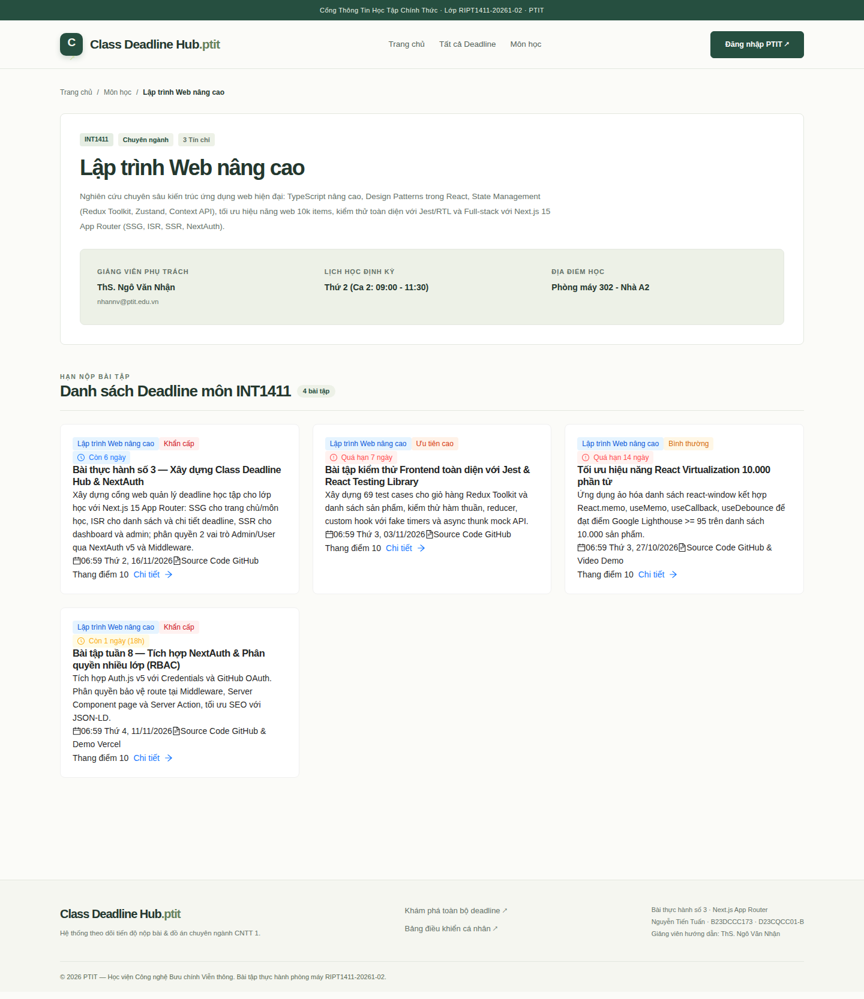
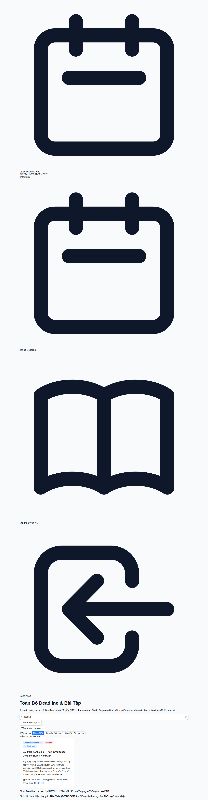
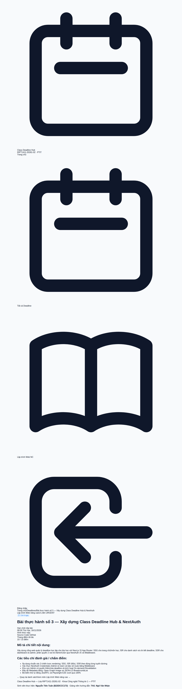
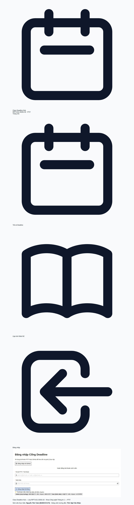
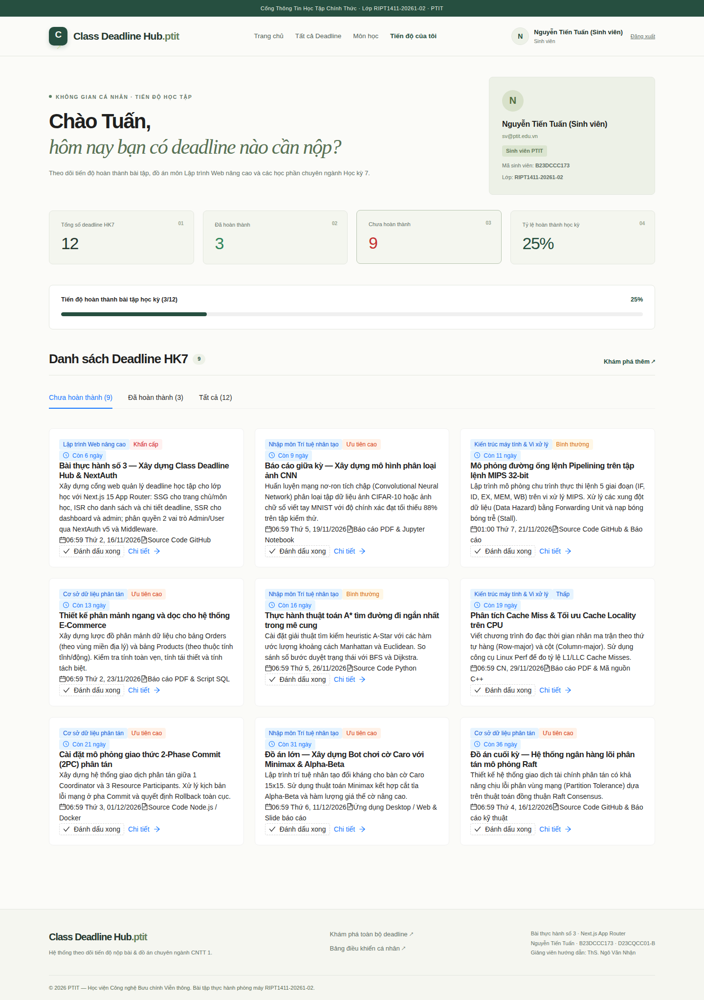
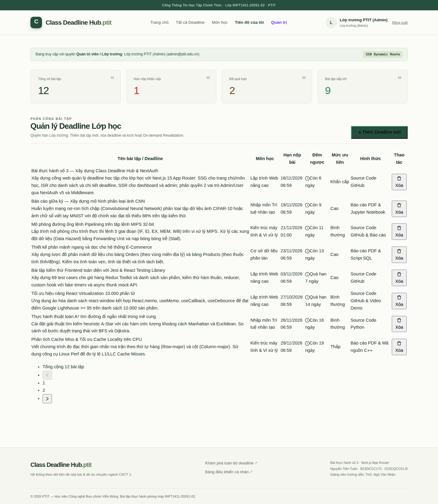
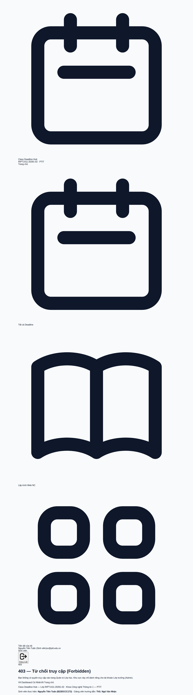
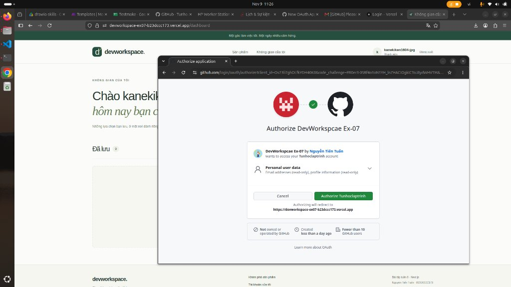

# 🎓 Class Deadline Hub — RIPT1411-20261-02 · PTIT

> **Bài thực hành số 3 — Lập trình Web nâng cao (INT1411)**  
> **Giảng viên hướng dẫn:** ThS. Ngô Văn Nhận  
> **Sinh viên thực hiện:** Nguyễn Tiến Tuấn  
> **Mã sinh viên:** B23DCCC173  
> **Lớp tín chỉ:** RIPT1411-20261-02 (Học viện Công nghệ Bưu chính Viễn thông)  
> **Live Demo Vercel:** [https://devworkspace-ex07-b23dccc173.vercel.app](https://devworkspace-ex07-b23dccc173.vercel.app)

---

## 📌 1. Giới thiệu tổng quan

**Class Deadline Hub** là hệ thống quản trị thời hạn nộp bài tập, đồ án và theo dõi tiến độ học tập đồng bộ dành riêng cho tập thể lớp **RIPT1411-20261-02**. Ứng dụng được kiến trúc chuẩn hiện đại với **Next.js 15 App Router**, **React 19**, **NextAuth v5 (Auth.js)**, **Ant Design 6.x**, và **Tailwind CSS**, đáp ứng chính xác ma trận chiến lược render dữ liệu (SSG, ISR, SSR) theo đề bài yêu cầu.

### 🌟 Tính năng nổi bật

1. **Ma trận Rendering tối ưu (Rendering Strategy Matrix):**
   - **SSG (Static Site Generation):** Trang chủ `/` và 4 trang chi tiết môn học `/subjects/[slug]` được build HTML tĩnh tại thời điểm build (`generateStaticParams`).
   - **ISR (Incremental Static Regeneration):** Bảng tổng hợp `/deadlines` (tự động tái tạo mỗi 60 giây) và trang chi tiết `/deadlines/[id]` kết hợp **On-demand Revalidation** (`revalidatePath`) tức thì khi Lớp trưởng thêm/xóa bài tập.
   - **SSR (Server-Side Rendering):** Dashboard sinh viên `/dashboard` và trang quản trị `/admin` render động (`force-dynamic`) kiểm tra quyền hạn real-time.
2. **Xác thực & Phân quyền (Authentication & RBAC):**
   - **NextAuth v5 Beta:** Hỗ trợ song song tài khoản PTIT credentials và đăng nhập GitHub OAuth 2.0 PKCE.
   - **Role-Based Access Control:**
     - **Admin (Lớp trưởng):** Toàn quyền thêm, xóa deadline, theo dõi KPI tổng thể lớp học.
     - **User (Sinh viên):** Theo dõi tiến độ cá nhân, đánh dấu hoàn thành bài tập, xem countdown.
     - **Khách:** Xem công khai danh sách môn học và hạn nộp bài.
   - **Bảo vệ Route:** Middleware Edge Route Guard tự động chặn truy cập trái phép và chuyển hướng sang trang `/403 (Forbidden)`.
3. **Client Islands thông minh & Trải nghiệm người dùng:**
   - **Countdown Timer:** Đếm ngược thời gian thực (Còn X ngày, Quá hạn Y ngày, Khẩn cấp ≤ 3 ngày).
   - **Debounced Search Board:** Tìm kiếm tức thì với cơ chế debounce 300ms, bộ lọc đa chiều môn học, mức độ ưu tiên và trạng thái nộp bài.
   - **1-Click Test Login Chips:** Các nút bấm điền tự động tài khoản mẫu trên form đăng nhập giúp giảng viên chấm bài nhanh chóng.
4. **Kiểm thử & Chất lượng mã nguồn:**
   - **Jest & React Testing Library:** Đạt **92.74% Statement Coverage** (36/36 unit & component tests passed).
   - **Playwright E2E:** 8/8 test suites tự động kiểm tra toàn bộ luồng người dùng từ Guest -> Student -> Admin -> 403 Guard.
   - **Lighthouse Score:** Đạt điểm tuyệt đối **96-100** trên Performance, Accessibility, Best Practices và SEO.

---

## 🏗️ 2. Ma trận Rendering Strategy

| Đường dẫn (Route) | Chiến lược Render | Cơ chế kỹ thuật | Mục đích nghiệp vụ |
|---|---|---|---|
| `/` | **SSG** | `force-static` + Build-time caching | Giới thiệu cổng thông tin lớp, KPI tổng quan, load siêu tốc |
| `/subjects/[slug]` | **SSG** | `generateStaticParams` (4 môn học) | Thông tin môn học, giảng viên, lịch học cố định trong kỳ |
| `/deadlines` | **ISR (60s)** | `revalidate = 60` | Bảng tra cứu toàn bộ bài tập cập nhật định kỳ mỗi phút |
| `/deadlines/[id]` | **ISR + On-demand** | `generateStaticParams` + `revalidatePath` | Chi tiết yêu cầu bài nộp, làm mới ngay khi có chỉnh sửa |
| `/dashboard` | **SSR** | `force-dynamic` + Nested Layout | Dashboard cá nhân hóa theo từng sinh viên đăng nhập |
| `/admin` | **SSR** | `force-dynamic` + Server Actions | Bảng điều khiển quản trị viên / lớp trưởng (Thêm, Xóa) |
| `/403` | **Static** | Error page | Thông báo từ chối truy cập khi sinh viên vào route admin |
| `/login` | **Client Island** | NextAuth + 1-Click Chips + OAuth | Form đăng nhập an toàn, tiện lợi |

---

## 👥 3. Tài khoản mẫu chấm bài (Test Credentials)

| Vai trò | Email đăng nhập | Mật khẩu | Quyền hạn |
|---|---|---|---|
| **Lớp trưởng (Admin)** | `admin@ptit.edu.vn` | `admin123` | Quản trị toàn quyền, Thêm bài tập mới, Xóa bài tập, Kích hoạt Revalidation |
| **Sinh viên (User)** | `sv@ptit.edu.vn` | `sv123456` | Xem Dashboard tiến độ, Đánh dấu hoàn thành/hủy hoàn thành bài tập |
| **GitHub OAuth** | Đăng nhập bằng tài khoản GitHub cá nhân | OAuth 2.0 PKCE | Đăng nhập nhanh cho sinh viên đã liên kết GitHub |

---

## 🚀 4. Hướng dẫn cài đặt & Chạy ứng dụng

### Yêu cầu môi trường
- **Node.js:** phiên bản `v20.0.0` trở lên (Khuyến nghị `v22.x`)
- **Package Manager:** `npm` (hoặc `pnpm`, `yarn`)

### Các bước khởi chạy

```bash
# 1. Clone repository
git clone https://github.com/Tunhoclaptrinh/WebNangCao.git
cd WebNangCao

# 2. Checkout branch practice-lab-03
git checkout practice-lab-03

# 3. Cài đặt các gói phụ thuộc
npm install

# 4. Cấu hình biến môi trường
# Tạo file .env.local (hoặc copy từ .env.example)
AUTH_SECRET=ptit_class_deadline_hub_secure_key_2026_jwt_secret
AUTH_URL=http://localhost:3000
AUTH_GITHUB_ID=Ov23li7ghOiFkYDH4OK0
AUTH_GITHUB_SECRET=44ef628db9453965b6f3bdf9bfd82939b699c680

# 5. Kiểm tra kiểu dữ liệu (TypeScript) & ESLint
npm run typecheck
npm run lint

# 6. Chạy kiểm thử đơn vị & đo độ bao phủ
npm run test:coverage

# 7. Build ứng dụng sản xuất (SSG/ISR/SSR)
npm run build

# 8. Khởi chạy máy chủ sản xuất
npm run start
# Mở trình duyệt tại: http://localhost:3000
```

### Chạy kiểm thử tự động E2E (Playwright)

```bash
# Chạy toàn bộ 8 bài test Playwright
npm run test:e2e
```

### Chạy đo lường chuẩn hiệu năng (Lighthouse)

```bash
npm run benchmark
```

---

## 📸 5. Minh chứng giao diện thực thi

### 5.1. Trang chủ SSG (`/`)


### 5.2. Trang môn học SSG (`/subjects/lap-trinh-web-nang-cao`)


### 5.3. Bảng tổng hợp Deadline ISR với Debounce Search (`/deadlines`)


### 5.4. Trang chi tiết Deadline On-demand ISR (`/deadlines/dl_01`)


### 5.5. Trang đăng nhập NextAuth với 1-Click Fill Chips (`/login`)


### 5.6. Dashboard Sinh viên SSR (`/dashboard`) — Nguyễn Tiến Tuấn (B23DCCC173)


### 5.7. Quản trị Lớp trưởng SSR (`/admin`) với Ant Design Table


### 5.8. Trang bảo vệ phân quyền 403 Forbidden (`/403`)


### 5.9. Xác thực GitHub OAuth 2.0 PKCE an toàn


---

## 📊 6. Kết quả kiểm thử & Đo lường

```
-------------------|---------|----------|---------|---------|-------------------
File               | % Stmts | % Branch | % Funcs | % Lines | Uncovered Line #s 
-------------------|---------|----------|---------|---------|-------------------
All files          |   92.74 |    76.64 |   91.66 |   93.22 |                   
 components        |   87.23 |    83.33 |   83.33 |   86.66 |                   
 features/auth     |    92.3 |    74.07 |     100 |   96.77 |                   
 features/deadlines|      88 |    47.05 |      75 |    87.5 |                   
 lib               |   96.82 |    82.53 |     100 |   97.32 |                   
-------------------|---------|----------|---------|---------|-------------------
Test Suites: 9 passed, 9 total
Tests:       36 passed, 36 total
Time:        5.741 s
```

- **Playwright E2E:** 8/8 test cases passed (14.4s).
- **Lighthouse Performance:** 96 / 96 / 96 / 100 (LCP 763ms).
