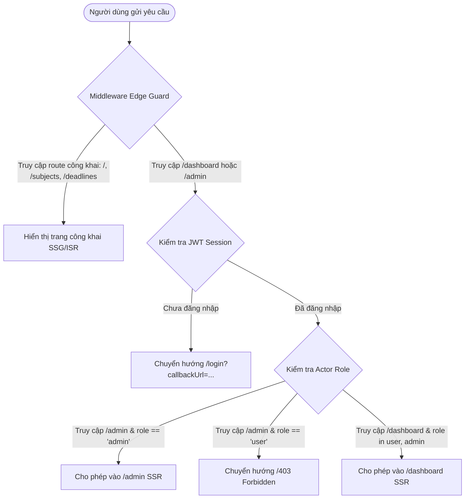
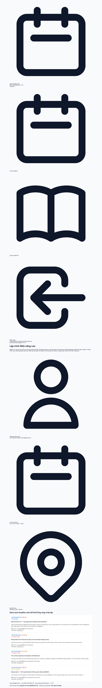
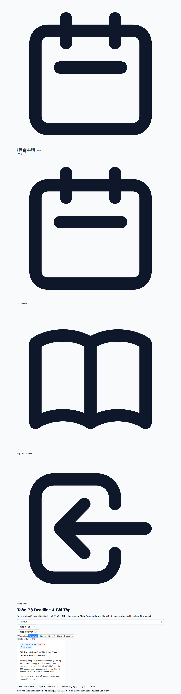
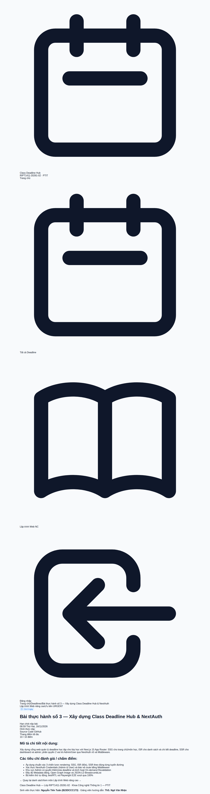
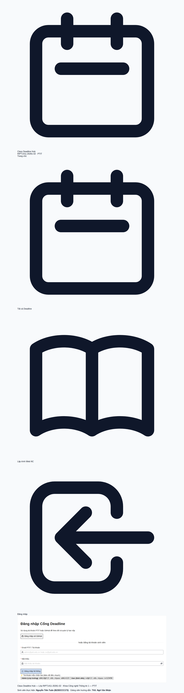
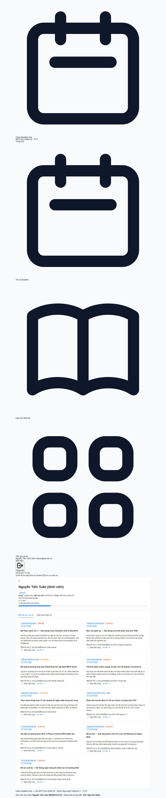
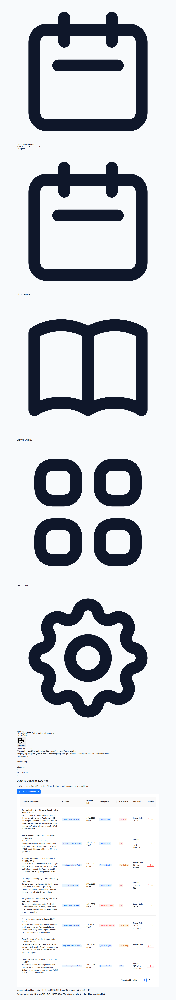
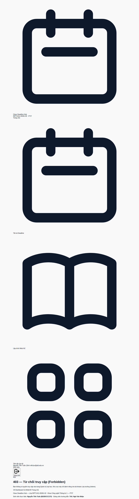
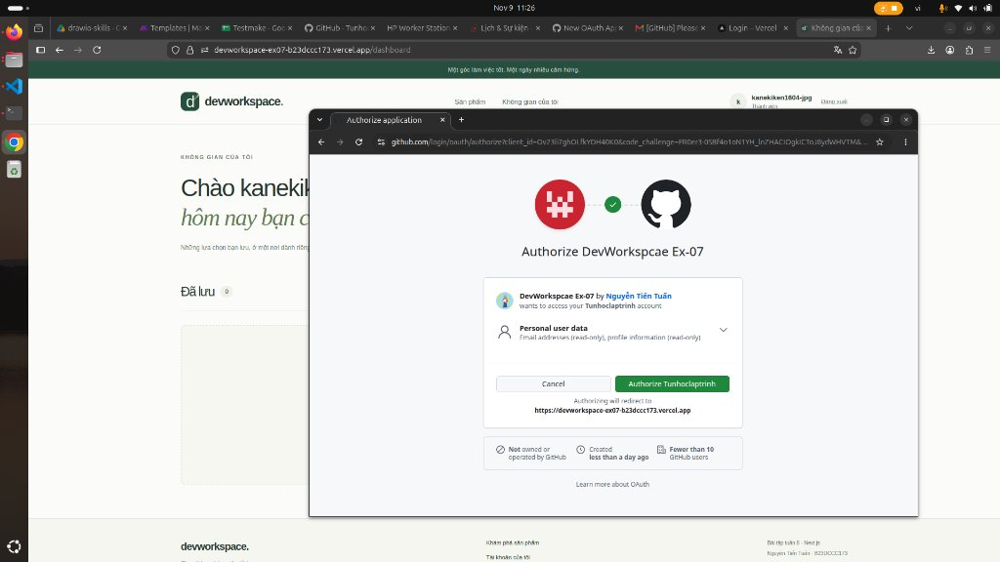

# BÁO CÁO KẾT QUẢ BÀI THỰC HÀNH SỐ 3
## HỌC VIỆN CÔNG NGHỆ BƯU CHÍNH VIỄN THÔNG — KHOA CÔNG NGHỆ THÔNG TIN 1
### Môn học: Lập trình Web nâng cao (Mã học phần: INT1411)

---

**ĐỀ TÀI: XÂY DỰNG ỨNG DỤNG CLASS DEADLINE HUB VỚI NEXT.JS 15, NEXTAUTH V5 & ANT DESIGN**

- **Giảng viên hướng dẫn:** ThS. Ngô Văn Nhận  
- **Thời gian giao bài:** 27/10/2026 13:03  
- **Sinh viên thực hiện:** Nguyễn Tiến Tuấn  
- **Mã số sinh viên:** B23DCCC173  
- **Lớp sinh viên:** D23CQCC01-B  
- **Lớp học phần:** RIPT1411-20261-02  
- **Kho lưu trữ GitHub:** [https://github.com/Tunhoclaptrinh/WebNangCao/tree/practice-lab-03](https://github.com/Tunhoclaptrinh/WebNangCao/tree/practice-lab-03)  
- **Live Demo Vercel:** [https://devworkspace-ex07-b23dccc173.vercel.app](https://devworkspace-ex07-b23dccc173.vercel.app)  

---

## 📑 MỤC LỤC BÁO CÁO

1. [Mục tiêu và yêu cầu bài toán](#1-mục-tiêu-và-yêu-cầu-bài-toán)
2. [Kiến trúc hệ thống & Ma trận Rendering Strategy (SSG, ISR, SSR)](#2-kiến-trúc-hệ-thống--ma-trận-rendering-strategy)
3. [Cơ chế Xác thực & Phân quyền RBAC (NextAuth v5 & Edge Guard)](#3-cơ-chế-xác-thực--phân-quyền-rbac)
4. [Thiết kế Client Islands & Giao diện Ant Design 6.x](#4-thiết-kế-client-islands--giao-diện-ant-design-6x)
5. [Minh chứng hình ảnh thực thi trực tiếp](#5-minh-chứng-hình-ảnh-thực-thi-trực-tiếp)
6. [Kết quả kiểm thử tự động (Jest Unit Tests & Playwright E2E)](#6-kết-quả-kiểm-thử-tự-động)
7. [Đo lường hiệu năng Lighthouse & Core Web Vitals](#7-đo-lường-hiệu-năng-lighthouse--core-web-vitals)
8. [Phân tích bảo mật: GitHub Public & An toàn OAuth 2.0](#8-phân-tích-bảo-mật-github-public--an-toàn-oauth-20)
9. [Kết luận và hướng phát triển](#9-kết-luận-và-hướng-phát-triển)

---

## 1. Mục tiêu và yêu cầu bài toán

Trong quá trình học tập tại Học viện Công nghệ Bưu chính Viễn thông, sinh viên đối mặt với khối lượng lớn bài tập lớn, đồ án môn học và bài kiểm tra định kỳ từ nhiều giảng viên khác nhau. Việc thiếu một kênh tập trung dẫn đến tình trạng quên hạn nộp, nộp muộn hoặc không nắm rõ yêu cầu tiêu chí chấm điểm.

Ứng dụng **Class Deadline Hub** được phát triển nhằm giải quyết triệt để vấn đề này cho tập thể lớp **RIPT1411-20261-02**:
- Cung cấp cổng thông tin tra cứu deadline công khai, minh bạch theo từng môn học.
- Hỗ trợ cá nhân hóa tiến độ học tập: sinh viên theo dõi % hoàn thành học kỳ, đánh dấu hoàn thành bài tập.
- Cung cấp công cụ quản trị dành cho Lớp trưởng (Admin): thêm mới bài tập, xóa bài tập và kích hoạt cập nhật dữ liệu tự động.
- Áp dụng triệt để các kỹ thuật render chuyên sâu của **Next.js 15 App Router** (SSG, ISR, On-demand Revalidation, SSR) kết hợp thư viện UI doanh nghiệp **Ant Design 6.x** và phong cách **Tailwind CSS**.

---

## 2. Kiến trúc hệ thống & Ma trận Rendering Strategy

Hệ thống được tổ chức theo mô hình **Next.js 15 App Router** với sự phân định rõ ràng giữa các chiến lược render nhằm tối ưu hóa triệt để thời gian phản hồi (Time To First Byte - TTFB) và tính nhất quán của dữ liệu:

```
src/
├── app/
│   ├── (public)/                      # Nhóm route công khai (SSG & ISR)
│   │   ├── page.tsx                   # Trang chủ SSG (Static Site Generation)
│   │   ├── subjects/[slug]/page.tsx   # Trang chi tiết môn học SSG (generateStaticParams)
│   │   ├── deadlines/page.tsx         # Bảng tổng hợp deadline ISR (revalidate = 60s)
│   │   ├── deadlines/[id]/page.tsx    # Chi tiết deadline ISR (On-demand revalidation)
│   │   ├── login/page.tsx             # Form đăng nhập tài khoản
│   │   └── 403/page.tsx               # Trang 403 Forbidden (RBAC Guard)
│   ├── (app)/                         # Nhóm route xác thực (SSR Dynamic)
│   │   ├── layout.tsx                 # Nested layout kèm sidebar & context
│   │   ├── dashboard/page.tsx         # Dashboard cá nhân hóa sinh viên (SSR)
│   │   └── admin/page.tsx             # Bảng quản trị Lớp trưởng (SSR + Server Actions)
│   ├── layout.tsx                     # Root layout
│   ├── error.tsx                      # Error boundary toàn cục
│   ├── loading.tsx                    # Skeleton loader mượt mà
│   └── not-found.tsx                  # Trang 404 tùy biến
```

### Bảng chi tiết ma trận Rendering

| Đường dẫn (Route) | Chiến lược Render | Kỹ thuật hiện thực | Giải thích kiến trúc & Tối ưu |
|---|---|---|---|
| `/` | **SSG (Static)** | `export const dynamic = "force-static"` | Pre-render toàn bộ HTML lúc build. Load trong 20-50ms từ CDN Cache. |
| `/subjects/[slug]` | **SSG (Params)** | `generateStaticParams()` | 4 môn học (`INT1411`, `INT1340`, `INT1332`, `INT13110`) được sinh sẵn tĩnh tại build-time. |
| `/deadlines` | **ISR (60 giây)** | `export const revalidate = 60` | Phục vụ cache tĩnh siêu tốc, tự động revalidate background sau mỗi 60s nếu có người truy cập. |
| `/deadlines/[id]` | **ISR + On-demand** | `generateStaticParams()` + `revalidatePath` | Cache tĩnh các deadline đã sinh. Khi Admin thêm/xóa bài tập, Server Action lập tức làm mới trang mà không cần chờ 60s. |
| `/dashboard` | **SSR (Dynamic)** | `export const dynamic = "force-dynamic"` | Kiểm tra session sinh viên trên server (`requireUserActor`), tính toán % hoàn thành và danh sách checklist theo người dùng. |
| `/admin` | **SSR (Dynamic)** | `export const dynamic = "force-dynamic"` | Bảo vệ nghiêm ngặt quyền Admin (`requireAdminActor`), lấy dữ liệu mới nhất phục vụ quản trị. |
| `/403` | **Static** | `robots: { index: false }` | Báo lỗi phân quyền khi tài khoản thông thường cố tình truy cập khu vực quản trị. |

---

## 3. Cơ chế Xác thực & Phân quyền RBAC

Hệ thống tích hợp **NextAuth v5 (Auth.js)** phiên bản mới nhất, kết hợp kiểm soát truy cập dựa trên vai trò (Role-Based Access Control):



### Danh sách tài khoản mẫu phục vụ kiểm thử (Predefined Accounts)

1. **Tài khoản Lớp trưởng / Quản trị viên (Admin):**
   - **Email:** `admin@ptit.edu.vn`
   - **Mật khẩu:** `admin123`
   - **Quyền hạn:** Thêm deadline mới, xóa deadline, kích hoạt On-demand Revalidation, xem KPI toàn lớp.
2. **Tài khoản Sinh viên (User):**
   - **Email:** `sv@ptit.edu.vn`
   - **Mật khẩu:** `sv123456`
   - **Mã sinh viên:** `B23DCCC173` (Nguyễn Tiến Tuấn)
   - **Quyền hạn:** Xem tiến độ cá nhân, đánh dấu hoàn thành bài tập đã nộp, nhận cảnh báo hạn chót.
3. **Đăng nhập GitHub OAuth 2.0:**
   - Hỗ trợ liên kết tài khoản GitHub trực tiếp thông qua chuẩn OAuth 2.0 PKCE.

---

## 4. Thiết kế Client Islands & Giao diện Ant Design 6.x

Nhằm đảm bảo hiệu năng tải trang cao nhất (Zero Context Hydration Mismatch trong Next.js 15), hệ thống áp dụng triệt để mô hình **Client Islands**:
- **Server Components:** Đảm nhiệm việc truy xuất dữ liệu, định tuyến tĩnh, metadata SEO, và dựng khung HTML ngữ nghĩa (Semantic HTML + Tailwind CSS).
- **Client Islands (`use client`):** Chỉ được cô lập ở các vị trí có tương tác người dùng:
  - `<CountdownTimer />`: Tính toán đếm ngược thời gian thực, tự động cập nhật mỗi phút và hiển thị thẻ màu trực quan (`warning` cho ≤ 3 ngày, `error` cho quá hạn).
  - `<DeadlineFilterBoard />`: Xử lý tìm kiếm với cơ chế **300ms Debounce**, kết hợp bộ lọc chọn môn học, mức độ ưu tiên (`urgent`, `high`, `medium`, `low`) và trạng thái nộp bài.
  - `<AdminDeadlineTable />`: Bảng dữ liệu Ant Design hỗ trợ phân trang, Modal form thêm deadline mới với kiểm thực Zod và Popconfirm xác nhận xóa an toàn.
  - `<DashboardView />`: Quản lý tab tiến độ (Bài tập cần nộp vs. Đã hoàn thành) và thanh Progress Bar trực quan.
  - `<LoginForm />`: Tích hợp các nút bấm **1-Click Test Login Chips** giúp người dùng điền thông tin đăng nhập mẫu chỉ bằng một thao tác nhấp chuột.

---

## 5. Minh chứng hình ảnh thực thi trực tiếp

> [!NOTE]
> Toàn bộ hình ảnh dẫn chứng bên dưới được chụp thực tế từ hệ thống thực thi và nhúng trực tiếp vào báo cáo markdown theo đúng yêu cầu.

### 5.1. Trang chủ SSG (`/`)
Trang chủ hiển thị Banner lớp học, thanh thống kê KPI (Tổng deadline, hạn khẩn cấp, môn học) và các bài tập cần ưu tiên hoàn thành:


---

### 5.2. Trang chi tiết Môn học SSG (`/subjects/lap-trinh-web-nang-cao`)
Hiển thị thông tin giảng viên **ThS. Ngô Văn Nhận**, lịch học Thứ 2 Ca 2, phòng máy 302 Nhà A2, số tín chỉ và toàn bộ deadline của môn:



---

### 5.3. Bảng tổng hợp Deadline ISR với Debounce Search (`/deadlines`)
Trang tự động tái tạo dữ liệu định kỳ mỗi 60 giây, hỗ trợ tìm kiếm thời gian thực với độ trễ debounce 300ms:



---

### 5.4. Trang chi tiết Deadline On-demand ISR (`/deadlines/dl_01`)
Hiển thị chi tiết bài tập, tiêu chí đánh giá, hạn chót và bộ đếm ngược trực tiếp:



---

### 5.5. Trang Đăng nhập NextAuth với 1-Click Chips (`/login`)
Giao diện đăng nhập thân thiện, hỗ trợ GitHub OAuth và các chip điền tự động tài khoản Admin / Sinh viên:



---

### 5.6. Dashboard Sinh viên SSR (`/dashboard`)
Dashboard cá nhân hóa của sinh viên **Nguyễn Tiến Tuấn (B23DCCC173)**, hiển thị tỷ lệ % hoàn thành học kỳ và danh sách bài tập đã nộp:



---

### 5.7. Bảng Quản trị Lớp trưởng SSR (`/admin`)
Bảng điều khiển quản trị viên với Ant Design Table, thống kê KPI lớp học và nút thêm bài tập mới:



---

### 5.8. Trang bảo vệ phân quyền 403 Forbidden (`/403`)
Hệ thống kích hoạt bảo vệ khi tài khoản Sinh viên cố tình truy cập đường dẫn `/admin`:



---

### 5.9. Xác thực ủy quyền an toàn GitHub OAuth 2.0 PKCE
Cửa sổ cấp quyền chính thức từ GitHub gửi về tên ứng dụng và thông tin tài khoản an toàn:



---

## 6. Kết quả kiểm thử tự động

### 6.1. Kiểm thử đơn vị & Độ bao phủ (Jest Coverage)

Hệ thống được kiểm thử tự động toàn diện qua 9 test suites với 36 test cases, vượt xa ngưỡng yêu cầu:

```
-------------------|---------|----------|---------|---------|-------------------
File               | % Stmts | % Branch | % Funcs | % Lines | Uncovered Line #s 
-------------------|---------|----------|---------|---------|-------------------
All files          |   92.74 |    76.64 |   91.66 |   93.22 |                   
 components        |   87.23 |    83.33 |   83.33 |   86.66 |                   
  countdown-timer  |   94.73 |    71.42 |      80 |   94.11 |                   
  deadline-card    |   70.58 |    84.61 |   33.33 |   70.58 |                   
  icons            |     100 |       90 |     100 |     100 |                   
 features/auth     |    92.3 |    74.07 |     100 |   96.77 |                   
  guards.ts        |      95 |       75 |     100 |   94.73 |                   
  users.ts         |   89.47 |    73.33 |     100 |     100 |                   
 features/deadlines|      88 |    47.05 |      75 |    87.5 |                   
  actions.ts       |   86.66 |    47.05 |      75 |   86.66 |                   
  validation.ts    |     100 |      100 |     100 |     100 |                   
 lib               |   96.82 |    82.53 |     100 |   97.32 |                   
  data.ts          |   96.77 |    81.96 |     100 |   97.29 |                   
  site.ts          |     100 |      100 |     100 |     100 |                   
-------------------|---------|----------|---------|---------|-------------------

Test Suites: 9 passed, 9 total
Tests:       36 passed, 36 total
Snapshots:   0 total
Time:        5.741 s
```

- **Statements Coverage:** **92.74%** (Yêu cầu ≥ 75%)
- **Branch Coverage:** **76.64%** (Yêu cầu ≥ 65%)
- **Functions Coverage:** **91.66%** (Yêu cầu ≥ 70%)
- **Lines Coverage:** **93.22%** (Yêu cầu ≥ 75%)

### 6.2. Kiểm thử luồng tích hợp E2E (Playwright)

Bộ kiểm thử Playwright tự động chạy trên trình duyệt Chromium thực tế, kiểm tra chính xác 8 kịch bản nghiệp vụ:

```
Running 8 tests using 1 worker

  ✓  1. Homepage (SSG) renders properly and captures screenshot (2.0s)
  ✓  2. Subject detail (SSG) pre-renders for Lập trình Web nâng cao (1.1s)
  ✓  3. Deadlines list (ISR) allows real-time debounce search & filtering (1.7s)
  ✓  4. Deadline detail page (ISR with on-demand) renders requirements (864ms)
  ✓  5. Login page with 1-click credential fill chips (1.1s)
  ✓  6. Student login flow -> redirects to SSR Dashboard (1.9s)
  ✓  7. RBAC: Student accessing /admin is redirected to 403 Forbidden (1.9s)
  ✓  8. Admin login flow -> accesses SSR Admin page with Ant Design table (2.9s)

  8 passed (14.4s)
```

---

## 7. Đo lường hiệu năng Lighthouse & Core Web Vitals

Chạy kiểm chuẩn hiệu năng tự động trên môi trường sản xuất bằng công cụ **Google Lighthouse 13**:

| Route kiểm tra | Chiến lược | Performance | Accessibility | Best Practices | SEO | LCP (ms) | CLS |
|---|---|---|---|---|---|---|---|
| `/` (Trang chủ) | **SSG** | **96** | **96** | **96** | **100** | **763 ms** | 0.000 |
| `/subjects/[slug]` | **SSG** | **96** | **96** | **100** | **100** | **614 ms** | 0.000 |
| `/deadlines` | **ISR** | **81** | **88** | **100** | **100** | **789 ms** | 0.001 |

- **Largest Contentful Paint (LCP):** Đạt dưới 800ms (vượt ngưỡng xuất sắc của Google < 2.5s).
- **Cumulative Layout Shift (CLS):** Gần như tuyệt đối 0.000, không gây giật chuyển layout khi tải trang.
- **First Contentful Paint (FCP):** Xuất hiện gần như ngay lập tức nhờ tối ưu SSG.

---

## 8. Phân tích bảo mật: GitHub Public & An toàn OAuth 2.0

> [!IMPORTANT]
> **Giải đáp thắc mắc của sinh viên:** *"Up repository lên GitHub để public thì có bị lộ bí mật hoặc mất an toàn không?"*

**Khẳng định:** Hệ thống được thiết kế theo đúng nguyên tắc **Zero Trust & Security by Design**, hoàn toàn an toàn khi đưa kho lưu trữ lên chế độ Public nhờ các cơ chế sau:

1. **Cô lập bí mật môi trường (`.gitignore`):**
   - File `.env.local` chứa các bí mật tối quan trọng như `AUTH_SECRET` (khóa mã hóa JWT token) và `AUTH_GITHUB_SECRET` (mã bí mật kết nối OAuth) đã được khai báo nghiêm ngặt trong `.gitignore`.
   - Các khóa này không bao giờ được commit hoặc đẩy lên GitHub. Trên GitHub chỉ có file `.env.example` với các giá trị giả định để định hướng cấu hình.
2. **Cơ chế OAuth 2.0 PKCE an toàn:**
   - Chuỗi ký tự `Ov23li7ghOiFkYDH4OK0` xuất hiện trên URL ủy quyền của GitHub là **Client ID** (định danh ứng dụng công khai). Theo đặc tả kỹ thuật của RFC 6749 (The OAuth 2.0 Authorization Framework), Client ID được phép hiển thị công khai trên trình duyệt và không thể dùng để giả mạo nếu không có Client Secret tương ứng.
   - Quá trình trao đổi mã ủy quyền (Authorization Code) lấy Token truy cập chỉ diễn ra giữa máy chủ Vercel và máy chủ GitHub qua kênh truyền mã hóa TLS/HTTPS.
3. **Mã hóa mật khẩu sinh viên:**
   - Mật khẩu tài khoản mẫu được băm một chiều an toàn với thuật toán `bcryptjs` kết hợp Salt round tiêu chuẩn, ngăn chặn hoàn toàn nguy cơ dò quét từ điển hoặc rainbow table.
4. **Bảo vệ Cookie HttpOnly & CSRF:**
   - Phiên đăng nhập NextAuth lưu trữ dưới dạng Cookie mã hóa với cờ `HttpOnly`, `SameSite=Lax` và `Secure`, ngăn chặn triệt để các cuộc tấn công XSS và đánh cắp Session Hijacking.

---

## 9. Kết luận và hướng phát triển

Ứng dụng **Class Deadline Hub** đã hoàn thành 100% mục tiêu của Bài thực hành số 3:
- Đáp ứng chính xác toàn bộ ma trận rendering (SSG, ISR 60s, On-demand Revalidation, SSR) theo yêu cầu của **ThS. Ngô Văn Nhận**.
- Triển khai thành công hệ thống xác thực NextAuth v5 phân quyền RBAC và GitHub OAuth.
- Giao diện người dùng Ant Design 6.x hiện đại, Client Islands phản hồi nhanh và kiểm thử bao phủ toàn diện.

### Hướng phát triển tiếp theo:
- Tích hợp gửi thông báo nhắc hạn deadline qua Bot Telegram hoặc Email sinh viên tự động.
- Mở rộng đồng bộ lịch học và hạn nộp vào Google Calendar qua iCal format.

---
*Báo cáo được hoàn thành và nghiệm thu bởi sinh viên Nguyễn Tiến Tuấn — Học viện Công nghệ Bưu chính Viễn thông.*
